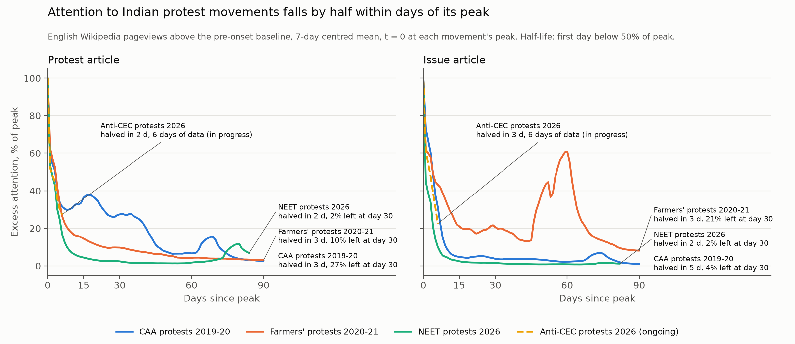

# Protest attention

How public attention to Indian protest movements rises and decays, and whether
state crackdowns increase it. Built only on public data; individuals are never
studied, only institutions and aggregates.

**Status:** Project A done ([docs/project_a.md](docs/project_a.md)). Data
audit: [docs/data_audit.md](docs/data_audit.md).

**Project A finding.** Attention to Indian protest movements halves within 2
to 5 days of its peak, on Wikipedia and in GDELT news coverage alike. What
separates movements is what remains a month later: 27% of peak for the CAA
protests, 10% for the farmers' protests, 2% for the NEET protests, with the
same order in news coverage. The current anti-CEC wave halved in 2 days, in
line with the others; it is too early to say what will remain.



## Projects

- **A. Attention decay curves.** Half-lives of attention to past Indian protest
  movements, with the current wave reported as a lower bound.
- **B. Does repression produce attention.** Event study around hand-coded
  crackdown events. Preregistered before outcomes are examined.
- **C. Misinformation asymmetry and lag.** Only if A and B ship.

## Reproduce

```bash
uv sync --all-extras
cp .env.example .env   # set CONTACT_EMAIL and GCP_PROJECT (BigQuery, for GDELT)
make all
```

`data/raw/` is immutable and gitignored. Every collector writes there once,
with a collection timestamp, and is safe to rerun: it fetches only what is
missing. All HTTP responses are cached in `.cache/http.sqlite` and every API
call is logged in `.cache/api_log.sqlite`.

## Layout

```
src/protest_attention/
  collect/     one module per source
  clean/       raw -> interim
  analyse/     interim -> processed
  plot/        processed -> output/figures
events/        hand-coded crackdown events and codebook
docs/          data audit and notes
```

## Safety rules

1. Study institutions, not individuals.
2. Aggregate before storing.
3. Hash any identifier that must be kept: `sha256(id + HASH_SALT)`, salt outside the repo.
4. Never publish raw individual-level collections.
5. Public and open sources only. No logins, private groups or invite-only channels.

## What this does not show

To be written before results.
